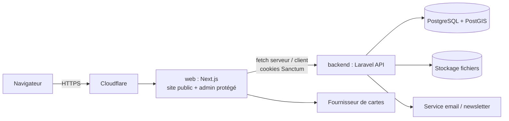

# CLAUDE.md — ProtectIci

> Source de vérité du projet. À lire en priorité avant toute génération de code, de modèle de données ou de design.
> Légende : **[ACTÉ]** décision confirmée par le porteur du projet · **[HYPOTHÈSE]** choix par défaut à confirmer/corriger · **[À DÉFINIR]** non décidé.

---

## 1. En-tête

| | |
|---|---|
| **Nom** | ProtectIci (écrit PROTECTICI dans la charte actuelle) |
| **Pitch** | Première plateforme d'information et de services en ligne dédiée à la sécurité et à la sûreté privées en Côte d'Ivoire. |
| **Domaine métier** | Sécurité / sûreté privée, annuaire de prestataires et de forces de l'ordre, mise en relation, information. |
| **Éditeur / opérateur** | FYG Technologies |
| **Langue du produit** | Français (Côte d'Ivoire). Devise : FCFA. |
| **État** | **Refonte** d'un site WordPress existant (https://protectici.fyg-technologies.com/). Aucun code écrit pour l'instant ; repo vide hormis ce fichier. Phase actuelle : cadrage (fichiers de contexte, design, sécurité, plan). |

---

## 2. Contexte fonctionnel

### 2.1 Description

ProtectIci, conçue en 2022, référence les entreprises de sécurité privée ivoiriennes (gardiennage, brigades canines, vidéosurveillance, alarmes, escorte, investigation, incendie, etc.), les établissements de formation et de certification, ainsi que les forces étatiques (police, etc.) avec les démarches associées. Elle propose aussi un canal de retour client (« Dis-moi tout ») et un blog d'information. Siège : Abidjan Plateau, immeuble Eden. Contact public actuel : info@protectici.ci, +225 07 09 44 51 11.

Mission affichée : protection des biens et des personnes, prévention et dissuasion, gestion de crise, contrôle d'accès et surveillance, enquête, conseil et audit. Valeurs : intégrité, fiabilité, professionnalisme, prévention.

**Objectif de la refonte [ACTÉ]** : refaire le site **à l'identique fonctionnellement**, avec un **meilleur design** (directives de design à venir de la part du porteur) et en **corrigeant ce qui était cassé** (voir §6.3). Des évolutions fonctionnelles viendront après la parité.

### 2.2 Types d'utilisateurs

| Rôle | Description |
|---|---|
| **Visiteur** | Particulier ou entreprise qui cherche un prestataire, lit le blog, consulte les forces étatiques. Non connecté. |
| **Utilisateur connecté** | Peut noter/commenter un prestataire, mettre en favori, soumettre « Dis-moi tout ». |
| **Prestataire / établissement** | Entreprise de sécurité, centre de formation, association, vendeur de matériel. S'inscrit via le formulaire d'inscription d'établissement. |
| **Administration étatique** | Établissement de type force/administration (police, commissariat…). Figure dans l'annuaire des forces étatiques. |
| **Administrateur** | Équipe ProtectIci / FYG. Modère les inscriptions, avis, contenus ; gère les référentiels. Accède à l'admin protégé. |

> [HYPOTHÈSE] Le détail des rôles/permissions côté admin (éditeur, modérateur, super-admin) sera précisé dans `security.md`.

### 2.3 Parcours principaux

1. **Trouver un prestataire** : recherche (titre, localisation, type d'entreprise, type de service) → liste → fiche → contact / devis / avis.
2. **Trouver une force étatique** : recherche par localisation, type de force, type de démarche (déposer plainte, signaler un fait suspect, déclaration de perte, constat d'accident, assistance pour cérémonie…) → fiche.
3. **S'inscrire comme établissement** : formulaire multi-étapes → validation par un administrateur → publication de la fiche.
4. **« Dis-moi tout »** : formulaire multi-étapes (infos client, prestataire concerné, type d'action, sujet) → enregistré, suivi par l'admin.
5. **Demander un devis** et **contacter** l'équipe.
6. **Lire le blog / actualités**, s'abonner à la newsletter.
7. **Se connecter / créer un compte** pour noter, commenter, mettre en favori.

### 2.4 Fonctionnalités clés par module

| Module | Contenu |
|---|---|
| **Annuaire prestataires** | Fiche : raison sociale, logo/images, description, tarif de départ, téléphone, site web, réseaux sociaux, adresse + position géographique, types d'entreprise, types de services (≈25), infos légales (RCCM, forme juridique, capital, objet social, n° d'agrément), dirigeants, contact d'urgence, note moyenne + avis, favori, partage (Facebook, X, LinkedIn, email, WhatsApp). Recherche multi-critères + par proximité. Section « populaires ». |
| **Forces étatiques** | Fiche par structure, filtre par type de force et type de démarche, recherche par proximité (« les plus proches »). |
| **Inscription établissement** | Multi-étapes : type d'établissement (prestataire privé / administration étatique) → infos personnelles → qualité (responsable, employé, autre) → type d'administration → services → raison sociale, ville, quartier, description géographique, contacts → « en service ? ». Workflow de modération. |
| **Dis-moi tout** | Civilité, nom, prénoms, email, téléphone ; prestataire concerné ; action (encouragement, question, plainte, suggestion) ; objet (employé, produit, prestation) ; type de prestation, lieu rattaché, sujet (courtoisie, rapidité d'intervention, disponibilité, ponctualité, tenue, professionnalisme, facturation/SAV, autres) ; commentaire. |
| **Demande de devis** | Formulaire de demande (détail des champs à relever sur l'ancien site). |
| **Contact** | Formulaire (nom, email, objet, message) + coordonnées. |
| **Blog / actualités** | Catégories : Actualités, Anti-intrusion, Cybercriminalité, Domotique, Emploi, Formation, Sécurité incendie. Compteur de vues, articles à la une / populaires, bandeau « Flash info » (défilant, avec heure). |
| **Pages institutionnelles** | Qui sommes-nous (mission, valeurs), Nos partenaires, Nos clients, mentions/pied de page. |
| **Newsletter** | Abonnement (Mailchimp sur l'ancien site). |
| **Comptes** | Inscription/connexion, favoris, avis. |
| **Admin** | CRUD de tous les contenus et référentiels, modération (établissements, avis, « Dis-moi tout », devis), tableau de bord. |

---

## 3. Architecture technique

### 3.1 Stack

| Couche | Choix | Statut |
|---|---|---|
| Front public + admin | **Next.js** (App Router), **TypeScript** | [ACTÉ] Next.js · [HYPOTHÈSE] TS, App Router |
| API | **Laravel** (API uniquement, aucune vue Blade métier), PHP 8.3+ | [ACTÉ] Laravel API-only · [HYPOTHÈSE] PHP 8.3 |
| Base de données | **PostgreSQL + PostGIS** | [ACTÉ] |
| Auth | **Laravel Sanctum**, mode SPA à **cookies httpOnly** + CSRF | [ACTÉ] |
| Conteneurs | Docker (images `postgis/postgis`, PHP-FPM, Node) | [ACTÉ] via Dockploy |
| Déploiement | **VPS + Dockploy**, derrière **Cloudflare** | [ACTÉ] |
| Tests API | Pest/PHPUnit | [HYPOTHÈSE] |
| Tests front | Vitest + Testing Library, Playwright pour l'E2E | [HYPOTHÈSE] |
| Styles | Tailwind CSS (+ composants maison/shadcn) | [HYPOTHÈSE] — à trancher avec `design.md` |
| Cartographie | **Leaflet + OpenStreetMap** (données gratuites). Les tuiles du serveur public `tile.openstreetmap.org` sont à usage limité : en production, passer par un fournisseur de tuiles OSM à quota gratuit (MapTiler, Stadia Maps…) ou auto-héberger. Choix du fournisseur de tuiles [À DÉFINIR] | [ACTÉ] OSM/Leaflet |
| Géocodage | **Nominatim (OSM)** avec cache en base et limite 1 requête/s, ou instance Photon/fournisseur à quota gratuit si besoin d'autocomplétion. Saisie manuelle/pointage sur carte des coordonnées en admin en secours (couverture inégale des quartiers ivoiriens) | [ACTÉ] OSM · [À DÉFINIR] service exact |
| Email | **Resend** (emails transactionnels : formulaires, validation d'inscription, notifications) | [ACTÉ] |
| Stockage fichiers | **Laravel Filesystem** : disque `local` en dev, driver **S3-compatible** en staging/production (recommandation : Cloudflare R2, voir §3.4) | [ACTÉ] Laravel Storage · [HYPOTHÈSE] R2 |

### 3.2 Schéma d'architecture



- Le **navigateur ne parle qu'à Next.js ou à l'API via le même domaine parent** (ex. `protectici.ci` et `api.protectici.ci`) afin que les cookies Sanctum fonctionnent (SameSite, CSRF).
- Next.js ne contient **aucune logique métier ni accès direct à la base** ; tout passe par l'API Laravel.
- L'admin est une zone protégée de l'application Next.js (`/admin/*`), authentifiée par la même API, avec contrôle des rôles côté API (le contrôle côté front n'est qu'un confort d'UX).

### 3.3 Arborescence du repo (monorepo) [ACTÉ : un dossier `backend`, un dossier `web`, un seul `CLAUDE.md`]

```
protectici/
├── CLAUDE.md              # ce fichier (unique, racine)
├── design.md              # (à venir) système visuel
├── security.md            # (à venir) politique de sécurité
├── plan_de_développement.md  # (à venir) phases et jalons
├── modele.md              # modèle de données (v1)
├── design/                # assets de marque (logo, icône) et maquette HTML de test
├── backend/               # Laravel (API uniquement)
│   ├── app/               #   Models, Http/Controllers, Services, Policies, Resources…
│   ├── database/          #   migrations, factories, seeders (données factices)
│   ├── routes/api.php
│   └── tests/
├── web/                   # Next.js
│   ├── src/app/           #   (public) et /admin (protégé)
│   ├── src/components/
│   ├── src/lib/           #   client API, auth, utilitaires
│   └── tests/
├── docker-compose.yml     # (à venir) dev local : db PostGIS, backend, web
└── .env.example           # (à venir) variables documentées, jamais de secrets réels
```

> [HYPOTHÈSE] Le détail interne de `backend/` et `web/` sera figé lors du scaffolding et mis à jour ici.

### 3.4 Services et dépendances externes

| Service | Rôle | Statut |
|---|---|---|
| Cloudflare | DNS, proxy, WAF, TLS, restriction de l'origine | [ACTÉ] |
| Dockploy (VPS) | Build et déploiement des conteneurs | [ACTÉ] |
| OpenStreetMap (Leaflet, tuiles, Nominatim) | Carte de l'annuaire, géocodage, recherche par proximité. Gratuit mais soumis à la politique d'usage OSM (User-Agent identifiable, cache, pas de requêtes massives, attribution « © OpenStreetMap » visible). | [ACTÉ] |
| Resend | Envoi des emails transactionnels (domaine d'envoi à vérifier : SPF/DKIM/DMARC). Newsletter : fonction Audiences/Broadcasts de Resend, ou outil dédié plus tard. | [ACTÉ] Resend · [À DÉFINIR] newsletter |
| Stockage des médias (logos, images) | Disque `local` (dev) → bucket S3-compatible (staging/prod) via le driver `s3` de Laravel. **Recommandé : Cloudflare R2** (10 Go gratuits, pas de frais de sortie, déjà dans l'écosystème Cloudflare). Alternative : volume Docker sur le VPS (simple mais lié au serveur, sauvegardes à gérer). | [HYPOTHÈSE] R2 |
| Anti-spam (Turnstile/hCaptcha) | Protection des formulaires publics | [HYPOTHÈSE] Cloudflare Turnstile |

---

## 4. Conventions de développement

> Tout ce chapitre est [HYPOTHÈSE] sauf mention contraire : valeurs par défaut raisonnables à corriger à la relecture.

### 4.1 Langue et nommage

- **Code, identifiants, commits, noms de tables/colonnes : anglais.** **Interface utilisateur, contenus, messages d'erreur affichés, documentation `.md` : français.**
- PHP : classes `PascalCase`, méthodes/variables `camelCase`, tables au pluriel `snake_case`, colonnes `snake_case`, routes API `kebab-case` pluriel (`/api/v1/providers`).
- TypeScript : composants `PascalCase`, fichiers de composants `PascalCase.tsx`, hooks `useXxx`, utilitaires `camelCase`, dossiers de routes `kebab-case`.
- Termes métier de référence (à utiliser tels quels dans le code) : `provider` (prestataire), `state_force` (force étatique), `establishment` (établissement), `service_type`, `company_type`, `feedback` (« Dis-moi tout »), `quote_request` (devis), `review`, `post` (article).

### 4.2 Style, linter, formatter

- Laravel : **Laravel Pint** (preset `laravel`), **Larastan** niveau ≥ 6.
- Next.js : **ESLint** (config Next + TypeScript strict), **Prettier**. `strict: true` dans `tsconfig`, pas de `any` sans justification.
- Commits : **Conventional Commits** (`feat:`, `fix:`, `chore:`…).

### 4.3 Pattern architectural

- **API** : Controllers minces → **FormRequests** pour la validation → **Services/Actions** pour la logique métier → **Policies** pour les autorisations → **API Resources** pour la sérialisation. Versionnement `/api/v1`.
- **Front** : composants serveur par défaut (SSR/ISR pour le SEO des fiches et du blog), composants clients uniquement pour l'interactivité (formulaires, carte, filtres). Un seul client API typé dans `web/src/lib`.
- **Pourquoi** : séparation nette API/UI, SEO fort pour l'annuaire et le blog, possibilité d'ajouter plus tard une application mobile sur la même API.

### 4.4 Erreurs, logs, tests

- API : format d'erreur JSON uniforme (code HTTP correct, `message`, `errors` par champ). Aucune trace/stack ni chemin serveur exposé : `APP_DEBUG=false` hors local, `display_errors` désactivé.
- Logs structurés (canal `stack` Laravel), sans données personnelles ni secrets. Côté front : error boundaries, pages `404`/`500` personnalisées.
- Tests : tout endpoint a au moins un test de succès, un de validation et un d'autorisation. Les migrations se testent sur PostgreSQL + PostGIS (pas SQLite). E2E sur les parcours principaux (§2.3).
- Aucune fonctionnalité n'est « terminée » sans tests passants, lint propre et vérification manuelle du parcours.

---

## 5. Contraintes et décisions actées

### 5.1 Contraintes non négociables

1. **Next.js (public + admin protégé) / Laravel (API uniquement)**. Pas de Blade métier, pas d'accès à la base depuis Next.js.
2. **PostgreSQL + PostGIS** ; la recherche par proximité doit rester possible.
3. **Auth par cookies httpOnly Sanctum** : aucun jeton d'auth dans `localStorage`/`sessionStorage`.
4. **Sécurité par défaut** : aucune erreur PHP/stack exposée publiquement, secrets uniquement dans l'environnement, validation côté serveur de tout formulaire, anti-spam sur les formulaires publics, autorisation vérifiée côté API. Détails dans `security.md`.
5. **Données personnelles et légales sensibles** (identité, RCCM, n° d'agrément) : accès restreint, jamais loguées, jamais exposées par l'API publique sans nécessité.
6. **Contenu en français correct**, sans texte lorem ni texte anglais de démonstration, sans fautes dans les référentiels.
7. **Mobile first**, accessibilité (WCAG 2.1 AA visée), bonnes performances sur réseau mobile.
8. **Données factices** pour le développement : aucune donnée réelle de prestataire ou d'utilisateur dans le repo.

### 5.2 Journal des décisions

| Date | Décision | Justification |
|---|---|---|
| 2026-10-07 | Refonte en Next.js + Laravel API au lieu de rester sur WordPress | Ancien site lourd (~20 plugins), erreurs nombreuses, difficile à faire évoluer et à sécuriser. |
| 2026-10-07 | Monorepo `backend/` + `web/`, un seul `CLAUDE.md` | Un seul porteur, docs communes, déploiement coordonné. |
| 2026-10-07 | PostgreSQL + PostGIS | Recherche « les plus proches » (forces étatiques, prestataires) au cœur du produit. |
| 2026-10-07 | Sanctum SPA, cookies httpOnly | Pas de jeton exposé au JS ; protection CSRF native. Exige un domaine parent commun web/api. |
| 2026-10-07 | VPS + Dockploy + Cloudflare | Maîtrise de l'infra ; durcissement et conteneurisation déjà cadrés (skills `containerize-for-dockploy`, `harden-dockploy-vps`). |
| 2026-10-07 | OpenStreetMap + Leaflet pour la carte et le géocodage | Gratuit ; pas de dépendance à une clé Google payante. Contrainte : respecter la politique d'usage OSM. |
| 2026-10-07 | Resend pour les emails | Choix du porteur ; API simple, bien supportée par Laravel. |
| 2026-10-07 | Laravel Storage, avec driver S3-compatible (R2) recommandé hors local | Les images ne doivent pas dépendre du disque d'un seul conteneur/VPS. |
| 2026-10-07 | Environnements staging et production | Recette avant mise en ligne. |
| 2026-10-07 | Validation admin obligatoire des fiches ; prestataire gère sa fiche via son compte (champs sensibles via demande validée) | Éviter les fausses fiches dans un annuaire de sécurité tout en gardant les fiches à jour. Détail dans `modele.md`. |
| 2026-10-07 | Avis : compte requis, 1 par utilisateur et prestataire, modérés | Limiter les faux avis et litiges. |
| 2026-10-07 | Rôles : `user`, `provider`, `editor` (blog), `admin` (tout) | Séparation simple des droits. Détail dans `security.md` à venir. |
| 2026-10-07 | Design différé : aucune maquette retenue ; fonctionnel d'abord avec UI neutre à base de jetons, puis « méga-refonte » (phase 6) | Choix du porteur ; évite de refaire les composants. |
| 2026-10-07 | Contenu factice calqué sur l'ancien site | Pas d'accès aux données réelles pour l'instant. |
| 2026-10-07 | Parité fonctionnelle d'abord, évolutions ensuite | Limiter le risque ; le design est piloté par le porteur. |

### 5.3 Défauts de l'ancien site à ne pas reproduire

- Erreurs PHP « Deprecated » affichées sur chaque page (fuite de chemins serveur et de versions).
- API REST exposant la liste des extensions ; fichiers `readme.html`/`license.txt` accessibles.
- Articles de démonstration en anglais (mode, voyage, crypto…) mélangés au contenu sécurité ; extraits lorem ; texte par défaut des flip-boxes.
- Carte « Implantation » non fonctionnelle.
- Fautes et incohérences dans les listes (« Alarm/ Control d'Accès », « Swipping », doublons).
- Pied de page « © 2018-2024 » alors que la plateforme date de 2022.
- Données de test mélangées à du contenu réel (ex. n° RCCM de 2026).

### 5.4 Hors scope (pour l'instant)

- Migration des données réelles depuis WordPress (hors parité, on part sur du factice).
- Application mobile native.
- Paiement en ligne, abonnements prestataires, marketplace de réservation.
- Module d'urgence/alerte temps réel.
- Multilingue (le français uniquement).
- Toute fonctionnalité nouvelle non demandée explicitement : à proposer, pas à implémenter.

---

## 6. Environnements et exécution

### 6.1 Environnements

| Env | Usage | Statut |
|---|---|---|
| **local** | Développement, `docker-compose` (db PostGIS) + serveurs de dev | [HYPOTHÈSE] |
| **staging** | Recette avant production, données factices, accès restreint (pas indexé, protégé par mot de passe ou Cloudflare Access). Ex. `staging.<domaine>` / `api-staging.<domaine>` | [ACTÉ] existe · [À DÉFINIR] URL |
| **production** | Site public. Ex. `<domaine>` / `api.<domaine>` | [ACTÉ] existe · [À DÉFINIR] domaine exact |

**Nom de domaine [À DÉFINIR]** : l'ancien site affiche `info@protectici.ci` et `www.protectici.com`, mais le domaine à utiliser pour la nouvelle application n'est pas confirmé. Web et API doivent partager le même domaine parent (cookies Sanctum). Staging et production sont deux déploiements Dockploy distincts, avec leurs propres bases, secrets et buckets.

L'ancien site WordPress (`protectici.fyg-technologies.com`) reste la **référence fonctionnelle** à consulter, pas un environnement de la nouvelle application.

### 6.2 Lancement en local [À CONFIRMER après scaffolding]

Commandes prévisionnelles (le repo est vide aujourd'hui, ne pas les considérer comme fonctionnelles) :

```bash
# 1. Base PostGIS
docker compose up -d db

# 2. API Laravel
cd backend
cp .env.example .env && composer install
php artisan key:generate
php artisan migrate --seed        # données factices
php artisan serve                 # http://localhost:8000

# 3. Front Next.js
cd ../web
cp .env.example .env.local && npm install
npm run dev                       # http://localhost:3000
```

> Pour que les cookies Sanctum fonctionnent en local, utiliser des hôtes du même domaine parent (ex. `localhost:3000` ↔ `localhost:8000`, ou `app.localhost` ↔ `api.localhost`) et configurer `SANCTUM_STATEFUL_DOMAINS` et `SESSION_DOMAIN`.

### 6.3 Procédure de déploiement [ACTÉ dans le principe, détails à venir]

1. Un service Dockploy par composant : `web`, `backend`, `db` (PostGIS) ; volumes persistants pour la base et les médias.
2. Variables d'environnement séparées build-time / runtime (voir skill `containerize-for-dockploy`).
3. Cloudflare devant l'origine ; ports 80/443 de l'origine limités aux IP Cloudflare ; SSH durci ; panneau Dockploy non exposé publiquement (voir skill `harden-dockploy-vps`).
4. Migrations exécutées au déploiement de l'API ; sauvegardes automatiques de la base.

---

## 7. Documents complémentaires

| Document | Rôle | Statut |
|---|---|---|
| `design.md` | Système et direction visuelle (tokens, composants, layout). Palette/logo repris de l'ancien site ; trois directions testées dans `design/maquette/index.html`. | **différé** — maquettes A/B/C rejetées ; seule l'identité (logo, palette, accessibilité) est valable. Refonte en phase 6. |
| `security.md` | Politique et spécifications de sécurité (authentification, autorisations, protection des données, conformité). **Ses règles priment** sur toute demande ponctuelle : signaler les conflits. | **v1 rédigée** |
| `plan_de_développement.md` | Plan détaillé : phases, jalons, historique des décisions de développement. | **v1 rédigée** (5 phases) |
| `modele.md` | Modélisation de la base : entités, relations, index (dont spatiaux), migrations. | **v1 rédigée** (proposition à relire) |

> Règle : ce fichier ne duplique pas ces documents. Toute IA doit les lire (lorsqu'ils existent) avant de travailler sur le sujet concerné, et signaler ici toute décision qui change l'identité ou l'architecture du projet.
