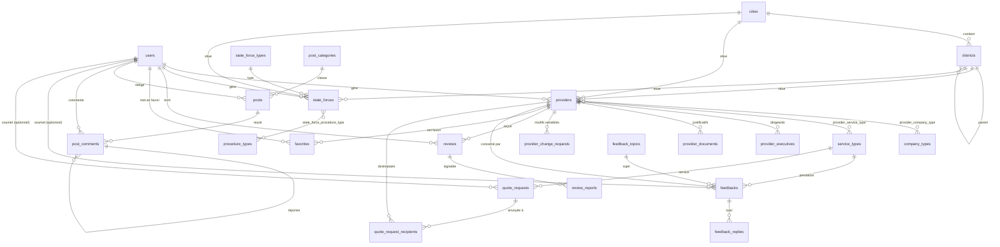

# modele.md — Modèle de données ProtectIci

> Spécification de la base de données. Contexte général, stack et conventions de code : voir `CLAUDE.md` (non dupliqués ici).
> Statut : **proposition v1** à relire. Légende : **[ACTÉ]** décidé · **[HYPOTHÈSE]** choix par défaut à confirmer · **[À RELEVER]** donnée à vérifier sur l'ancien site.
> `plan_de_développement.md` n'existe pas encore : aucune contrainte historique n'a été prise en compte.

---

## 0. Entrées de cadrage

| Variable | Valeur retenue | Statut |
|---|---|---|
| Type de base | Relationnelle | [ACTÉ] (cf. `CLAUDE.md` §3) |
| SGBD | **PostgreSQL 16+ avec PostGIS** (extensions : `postgis`, `citext`, `unaccent`, `pg_trgm`) | [ACTÉ] PG+PostGIS · [HYPOTHÈSE] extensions/version |
| ORM | **Eloquent** (Laravel), migrations Laravel | [ACTÉ] |
| Multi-tenant | Non (une seule instance, un seul « tenant ») | [HYPOTHÈSE] |
| Temps réel | Non (pas de LISTEN/NOTIFY ni de websockets) | [HYPOTHÈSE] |
| Volumétrie (an 1–3) | Prestataires < 5 000 · forces étatiques < 2 000 · utilisateurs < 100 000 · avis < 200 000 · feedbacks < 100 000 · devis < 100 000 · articles < 2 000 | [HYPOTHÈSE] |
| Environnements | local, staging, production, une base chacun | [ACTÉ] |
| Intégrations | Resend (email), OpenStreetMap/Nominatim (coordonnées), stockage S3-compatible (fichiers) | [ACTÉ] (cf. `CLAUDE.md` §3.4) |
| Conformité | Loi ivoirienne n° 2013-450 du 19 juin 2013 sur la protection des données à caractère personnel (autorité : ARTCI) | [HYPOTHÈSE] à valider juridiquement |

**Règles de gestion actées**

| # | Règle |
|---|---|
| RG1 | **Validation admin obligatoire** de toute fiche (prestataire ou force étatique) soumise par le formulaire d'inscription : statut `pending` → `approved` ou `rejected` (avec motif). Rien n'est public avant `approved`. |
| RG2 | Le prestataire **gère sa fiche via son compte** (rôle `provider`). Les champs sensibles (raison sociale, RCCM, n° d'agrément, forme juridique, capital, objet social) ne sont **pas modifiés directement** : la modification passe par une `provider_change_requests` validée par un admin. |
| RG3 | **Avis** : compte requis, **un avis par utilisateur et par prestataire**, note entière 1–5, **modération avant affichage**, droit de réponse unique du prestataire, signalement possible. |
| RG4 | **Rôles** : `user`, `provider` (publics) et `editor`, `admin` (administration). `admin` = tout (annuaire, modération, utilisateurs, paramètres) ; `editor` = blog uniquement (articles, catégories, commentaires du blog). |
| RG5 | « Dis-moi tout » et devis : formulaires **ouverts aux visiteurs** (compte facultatif), avec consentement horodaté et référence de suivi. [HYPOTHÈSE] |
| RG6 | Un utilisateur `provider` peut gérer **plusieurs** fiches (ex. entreprise à plusieurs agences). [HYPOTHÈSE] |
| RG7 | Les avis ne portent que sur les **prestataires** (pas sur les forces étatiques). [HYPOTHÈSE] |
| RG8 | La suppression applicative est **logique** (`deleted_at`) pour les entités métier ; la suppression physique est réservée à l'anonymisation/purge RGPD-like (§5.3). |

---

## 1. Vue d'ensemble

### 1.1 Résumé conceptuel

Le modèle est organisé en neuf blocs : **identité et accès** (`users`), **géographie** (villes/communes/quartiers), **référentiels** (types d'entreprise, de service, de force, de démarche, sujets de feedback), **annuaire** (prestataires, forces étatiques, médias, documents justificatifs, demandes de modification), **engagement** (avis, signalements, favoris), **relation client** (« Dis-moi tout », devis, contact), **contenu éditorial** (articles, catégories, commentaires, pages, partenaires), **newsletter**, et des **tables techniques** (paramètres, audit, consentements, notifications, files Laravel). La géolocalisation repose sur des colonnes `latitude`/`longitude` et une colonne `location geography(Point,4326)` **générée** et indexée en GiST pour la recherche par proximité.

### 1.2 Choix du SGBD

PostgreSQL + PostGIS est **imposé** (cf. `CLAUDE.md` §5.1) : requêtes « les plus proches » en mètres (`ST_DWithin`, opérateur `<->`), recherche plein texte française (`tsvector`) et recherche floue (`pg_trgm`), types `jsonb`, contraintes `CHECK` et index partiels.

### 1.3 ORM et implications

| Sujet | Décision |
|---|---|
| ORM | **Eloquent** (Laravel), pas de SQL natif dans le code applicatif sauf fonctions spatiales (`DB::raw`/scopes dédiés). |
| Nommage | Tables **pluriel snake_case anglais**, clé primaire `id`, clés étrangères `{singulier}_id`, pivots en ordre alphabétique singulier (`provider_service_type`), timestamps `created_at`/`updated_at`, suppression logique `deleted_at` (`SoftDeletes`). |
| Types | `id` : `bigint` identité (`$table->id()`). Dates : `timestamptz`. Booléens : `boolean`. Énumérations : `varchar` + `CHECK` (pas de `ENUM` natif PostgreSQL, plus simple à migrer). Emails : `citext`. |
| Migrations | Natives Laravel. Les éléments non supportés par le Schema Builder (extensions, colonnes générées, `geography`, GiST, `CHECK`, triggers, fonctions) sont écrits en `DB::statement()` dans des migrations dédiées. |
| Spatial | Paquet recommandé : `matanyadaev/laravel-eloquent-spatial` [HYPOTHÈSE]. À défaut, requêtes SQL brutes encapsulées dans des scopes (`scopeNear`). |
| Particularités | Colonnes générées (`location`) en lecture seule côté Eloquent (`$guarded`/exclues de `$fillable`). `updated_at` est géré par Eloquent : toute mise à jour en SQL brut doit le positionner. Pas de morph polymorphe sans `Relation::enforceMorphMap`. |

### 1.4 Schéma entité-relation

Relations **polymorphes sans clé étrangère** : `media` (→ `providers`, `state_forces`, `posts`, `partners`, `users`), `audit_logs` (→ toute entité), `notifications` (→ `users`). L'intégrité y est assurée par l'application (morph map obligatoire) et des jobs de nettoyage.

---

## 2. Dictionnaire des entités

### 2.0 Conventions communes

- Légende des colonnes : `NN` = NOT NULL · `Null` = nullable · `PK` · `FK`.
- Tout `varchar(n)` a une longueur maximale explicite. Toute colonne `*_at` est `timestamptz`.
- **Colonnes de suivi (non répétées dans chaque tableau)** : `created_at timestamptz NN DEFAULT now()`, `updated_at timestamptz NN DEFAULT now()`, et `deleted_at timestamptz Null` **uniquement sur les tables marquées « SD »** (soft delete).
- **Règle `is_visible`** : `boolean NN DEFAULT false`, présente sur toutes les tables contenant des données publiables. Elle est **indépendante** de `status` et `deleted_at`. Une donnée est exposée par l'API publique **si et seulement si** : `is_visible = true` **ET** `deleted_at IS NULL` **ET** (le cas échéant) `status` à la valeur « publiée/approuvée ». Les référentiels et pages sont seedés avec `is_visible = true`.

### 2.1 Récapitulatif `is_visible`

| Table | `is_visible` | Justification |
|---|---|---|
| `users` | Exclue | Compte d'authentification, jamais publiable. |
| `password_reset_tokens`, `sessions` | Exclue | Technique. |
| `cities`, `districts` | **Incluse** | Référentiel affiché dans les filtres/formulaires. |
| `company_types`, `service_types`, `state_force_types`, `procedure_types`, `feedback_topics` | **Incluse** | Référentiels affichés publiquement ; permet de retirer une valeur sans la supprimer. |
| `providers`, `state_forces` | **Incluse** | Fiches publiables. |
| `provider_executives` | **Incluse** | Données personnelles de dirigeants : affichage choisi fiche par fiche. |
| `provider_company_type`, `provider_service_type`, `state_force_procedure_type` | Exclue | Tables de jonction. |
| `provider_documents`, `provider_change_requests` | Exclue | Privées (justificatifs, workflow interne), jamais publiques. |
| `media` | Exclue | Visibilité héritée de l'entité parente (`mediable`). |
| `reviews` | **Incluse** | Avis publiable après modération. |
| `review_reports` | Exclue | Modération interne. |
| `favorites` | Exclue | Jonction, donnée privée de l'utilisateur. |
| `feedbacks`, `feedback_replies` | Exclue | Données personnelles privées, traitées en interne ; aucune publication prévue. (Si des « encouragements » sont un jour affichés, ajouter la colonne par migration.) |
| `quote_requests`, `quote_request_recipients`, `contact_messages` | Exclue | Données personnelles privées. |
| `post_categories`, `posts`, `post_comments`, `pages`, `partners` | **Incluse** | Contenu éditorial publiable. |
| `newsletter_subscribers` | Exclue | Données personnelles privées. |
| `settings` | Exclue | Configuration technique ; l'exposition au front est pilotée par `settings.is_public`. |
| `audit_logs`, `consent_logs`, `notifications`, `jobs`, `job_batches`, `failed_jobs`, `cache`, `cache_locks`, `migrations` | Exclue | Techniques. |

---

### 2.2 Identité et accès

#### `users` (SD)
Comptes de tous les acteurs authentifiés.

| Colonne | Type | Null | Défaut | Contraintes / notes |
|---|---|---|---|---|
| id | bigint identity | NN | | **PK** |
| first_name | varchar(100) | NN | | |
| last_name | varchar(100) | NN | | |
| email | citext | NN | | UNIQUE (partiel : `WHERE deleted_at IS NULL`) |
| email_verified_at | timestamptz | Null | | Vérification obligatoire avant avis/favoris |
| password | varchar(255) | NN | | Hash Argon2id/bcrypt, jamais en clair |
| phone | varchar(30) | Null | | Format E.164 recommandé (`+225…`) |
| role | varchar(20) | NN | `'user'` | CHECK `IN ('user','provider','editor','admin')` |
| is_active | boolean | NN | `true` | Désactivation sans suppression |
| two_factor_secret | text | Null | | Chiffré (cast `encrypted`) |
| two_factor_recovery_codes | text | Null | | Chiffré (cast `encrypted`) |
| two_factor_confirmed_at | timestamptz | Null | | 2FA exigé pour `admin` et `editor` (règle applicative) |
| last_login_at | timestamptz | Null | | |
| remember_token | varchar(100) | Null | | |

Relations : 1-N vers `providers`, `state_forces`, `reviews`, `posts`, `post_comments`, `feedbacks`, `quote_requests`, `favorites`. `is_visible` : exclue (cf. §2.1).

#### `password_reset_tokens`
| Colonne | Type | Null | Défaut | Contraintes |
|---|---|---|---|---|
| email | citext | NN | | **PK** |
| token | varchar(255) | NN | | Hash du jeton |
| created_at | timestamptz | Null | | Expiration 60 min (config) |

#### `sessions`
Session Laravel (driver `database`) utilisée par Sanctum SPA.
| Colonne | Type | Null | Défaut | Contraintes |
|---|---|---|---|---|
| id | varchar(255) | NN | | **PK** |
| user_id | bigint | Null | | FK → `users.id` ON DELETE CASCADE, index |
| ip_address | varchar(45) | Null | | |
| user_agent | text | Null | | |
| payload | text | NN | | |
| last_activity | integer | NN | | Index |

---

### 2.3 Géographie

#### `cities`
| Colonne | Type | Null | Défaut | Contraintes |
|---|---|---|---|---|
| id | bigint identity | NN | | **PK** |
| name | varchar(120) | NN | | |
| slug | varchar(140) | NN | | UNIQUE |
| country_code | char(2) | NN | `'CI'` | |
| latitude | numeric(9,6) | Null | | CHECK −90..90 |
| longitude | numeric(9,6) | Null | | CHECK −180..180 |
| location | geography(Point,4326) | Null | | **GENERATED ALWAYS** `ST_SetSRID(ST_MakePoint(longitude,latitude),4326)::geography` STORED (NULL si lat/lng NULL) |
| sort_order | smallint | NN | `0` | |
| is_visible | boolean | NN | `false` | cf. §2.1 |

#### `districts` (communes et quartiers)
| Colonne | Type | Null | Défaut | Contraintes |
|---|---|---|---|---|
| id | bigint identity | NN | | **PK** |
| city_id | bigint | NN | | FK → `cities.id` ON DELETE RESTRICT |
| parent_id | bigint | Null | | FK → `districts.id` ON DELETE RESTRICT (commune → quartier) ; CHECK `parent_id <> id` |
| name | varchar(120) | NN | | |
| slug | varchar(140) | NN | | UNIQUE (`city_id`, `slug`) |
| latitude / longitude / location | idem `cities` | Null | | |
| is_visible | boolean | NN | `false` | |

Relations : `cities` 1-N `districts` ; `districts` 1-N `districts` (auto-référence). Remplace les champs texte libres « ville » et « quartier » de l'ancien formulaire.

---

### 2.4 Référentiels

Cinq tables de structure identique `slug / name / description / sort_order / is_visible`. Colonnes communes :

| Colonne | Type | Null | Défaut | Contraintes |
|---|---|---|---|---|
| id | bigint identity | NN | | **PK** |
| slug | varchar(120) | NN | | UNIQUE |
| name | varchar(150) | NN | | |
| description | text | Null | | |
| sort_order | smallint | NN | `0` | |
| is_visible | boolean | NN | `false` | |

Colonne additionnelle : `service_types.icon varchar(60) Null` (nom d'icône du design system).

| Table | Rôle | Valeurs de seed (corrigées par rapport à l'ancien site) |
|---|---|---|
| `company_types` | Type d'établissement prestataire | Entreprise de sécurité et sûreté agréée · Établissement de certification en sécurité et sûreté · Établissement de formation d'entraînement en sécurité et sûreté · Association et club · Centre de formation · Société de vente et d'installation de matériel de sécurité |
| `service_types` | Type de service (≈ 24) | Alarme / contrôle d'accès / système anti-intrusion · Assistance / intervention · Audit de sécurité · Brigade canine · Brigade canine de détection · Escorte · Exfiltration / évacuation · Formation · Garde rapprochée · Gardiennage armé · Gardiennage non armé · Hôtesse / steward de sécurité · Investigation / détective privé · Location de matériel de sécurité · Sécurité événementielle · Sécurité incendie · Sécurité informatique · Sécurité maritime · Sécurité portuaire et aéroportuaire · Sweeping électronique · Tracking de véhicules · Veille sécuritaire · Vente de matériel de sécurité et de sûreté · Vidéosurveillance |
| `state_force_types` | Type de force étatique | Police (commissariat) [constaté] · Gendarmerie · Sapeurs-pompiers [HYPOTHÈSE] — liste complète **[À RELEVER]** |
| `procedure_types` | Type de démarche | Déposer une plainte · Signaler un fait suspect · Déclaration de perte · Demander un constat d'accident de circulation · Demander une assistance des forces de l'ordre pour une cérémonie · (une 6e option « assistance… » tronquée sur l'ancien site **[À RELEVER]**) |
| `feedback_topics` | Sujet de « Dis-moi tout » | Courtoisie des agents · Rapidité / célérité d'intervention · Disponibilité · Ponctualité · Tenue et propreté des agents · Professionnalisme et qualité du service · Facturation / service après-vente · Autres |

`is_visible` : incluse sur les cinq (cf. §2.1). Les anciennes valeurs mal orthographiées (« Alarm/ Control », « Swipping », « detection ») ne sont **pas** reprises.

---

### 2.5 Annuaire

#### `providers` (SD)
Fiche d'un prestataire de sécurité/sûreté privée.

| Colonne | Type | Null | Défaut | Contraintes / notes |
|---|---|---|---|---|
| id | bigint identity | NN | | **PK** |
| user_id | bigint | Null | | FK → `users.id` ON DELETE SET NULL (propriétaire) |
| name | varchar(200) | NN | | Raison sociale / nom commercial |
| slug | varchar(220) | NN | | UNIQUE |
| description | text | Null | | |
| price_from | integer | Null | | Tarif de départ en FCFA ; CHECK `>= 0` |
| phone | varchar(30) | NN | | |
| phone_alt | varchar(30) | Null | | |
| emergency_phone | varchar(30) | Null | | « Contact d'urgence » |
| email | citext | Null | | |
| website_url | varchar(255) | Null | | URL http(s) validée |
| facebook_url | varchar(255) | Null | | |
| instagram_url | varchar(255) | Null | | |
| twitter_url | varchar(255) | Null | | |
| linkedin_url | varchar(255) | Null | | |
| whatsapp_number | varchar(30) | Null | | |
| address | varchar(255) | Null | | |
| city_id | bigint | NN | | FK → `cities.id` ON DELETE RESTRICT |
| district_id | bigint | Null | | FK → `districts.id` ON DELETE SET NULL |
| geo_description | text | Null | | « Description géographique » |
| plus_code | varchar(20) | Null | | Ex. « 9277+PCJ » |
| latitude | numeric(9,6) | Null | | CHECK −90..90 |
| longitude | numeric(9,6) | Null | | CHECK −180..180 |
| location | geography(Point,4326) | Null | | GENERATED STORED (cf. `cities`) |
| rccm | varchar(50) | Null | | Registre de commerce ; UNIQUE partiel (`WHERE rccm IS NOT NULL AND deleted_at IS NULL`) |
| legal_form | varchar(30) | Null | | CHECK `IN ('sarl','sa','sas','suarl','ei','association','other')` |
| share_capital | bigint | Null | | FCFA ; CHECK `>= 0` |
| corporate_purpose | text | Null | | Objet social |
| approval_number | varchar(50) | Null | | N° d'agrément ; UNIQUE partiel |
| approval_expires_at | date | Null | | [HYPOTHÈSE] pour alerter avant expiration |
| submitter_role | varchar(20) | Null | | Qualité du déclarant ; CHECK `IN ('manager','employee','other')` |
| is_in_service | boolean | NN | `true` | « En service dans cet établissement ? » |
| status | varchar(20) | NN | `'pending'` | CHECK `IN ('draft','pending','approved','rejected','suspended')` |
| rejection_reason | text | Null | | Obligatoire si `status='rejected'` (CHECK) |
| reviewed_by | bigint | Null | | FK → `users.id` ON DELETE SET NULL |
| reviewed_at | timestamptz | Null | | |
| is_verified | boolean | NN | `false` | Badge « vérifié » (agrément contrôlé) |
| verified_at | timestamptz | Null | | |
| is_featured | boolean | NN | `false` | Mise en avant « populaires » |
| views_count | integer | NN | `0` | CHECK `>= 0` |
| rating_avg | numeric(3,2) | NN | `0` | Dénormalisé (trigger §5.1), CHECK 0..5 |
| rating_count | integer | NN | `0` | Dénormalisé (trigger) |
| search_vector | tsvector | Null | | Maintenu par trigger (§5.1) |
| is_visible | boolean | NN | `false` | cf. §2.1 |

Contraintes métier :
- `CHECK (NOT is_visible OR status = 'approved')` : une fiche non validée ne peut jamais être publique (RG1).
- `CHECK (status <> 'rejected' OR rejection_reason IS NOT NULL)`.
- `CHECK ((latitude IS NULL) = (longitude IS NULL))`.

Relations : N-1 `users` (propriétaire), N-1 `cities`, N-1 `districts` ; N-N `company_types` et `service_types` ; 1-N `provider_executives`, `provider_documents`, `provider_change_requests`, `reviews`, `favorites`, `feedbacks`, `quote_request_recipients`. Médias via `media` (collections `logo`, `cover`, `gallery`).

#### `provider_company_type` (jonction)
| Colonne | Type | Null | Contraintes |
|---|---|---|---|
| provider_id | bigint | NN | FK → `providers.id` ON DELETE CASCADE |
| company_type_id | bigint | NN | FK → `company_types.id` ON DELETE RESTRICT |
| | | | **PK** (`provider_id`, `company_type_id`) |

#### `provider_service_type` (jonction)
| Colonne | Type | Null | Contraintes |
|---|---|---|---|
| provider_id | bigint | NN | FK → `providers.id` ON DELETE CASCADE |
| service_type_id | bigint | NN | FK → `service_types.id` ON DELETE RESTRICT |
| | | | **PK** (`provider_id`, `service_type_id`) |

#### `provider_executives`
| Colonne | Type | Null | Défaut | Contraintes |
|---|---|---|---|---|
| id | bigint identity | NN | | **PK** |
| provider_id | bigint | NN | | FK → `providers.id` ON DELETE CASCADE |
| full_name | varchar(150) | NN | | |
| position | varchar(30) | NN | | CHECK `IN ('general_manager','commercial_manager','operations_manager','other')` |
| position_label | varchar(100) | Null | | Libellé libre si `other` |
| sort_order | smallint | NN | `0` | |
| is_visible | boolean | NN | `false` | Consentement d'affichage du dirigeant |

#### `provider_documents` (SD) — **privé**
Justificatifs téléversés pour la validation (RG1).
| Colonne | Type | Null | Défaut | Contraintes |
|---|---|---|---|---|
| id | bigint identity | NN | | **PK** |
| provider_id | bigint | NN | | FK → `providers.id` ON DELETE CASCADE |
| type | varchar(30) | NN | | CHECK `IN ('approval_certificate','rccm_extract','id_document','other')` |
| disk | varchar(20) | NN | `'private'` | Disque Laravel **non public** |
| path | varchar(500) | NN | | |
| original_name | varchar(255) | NN | | |
| mime_type | varchar(100) | NN | | CHECK `IN ('application/pdf','image/jpeg','image/png')` |
| size_bytes | integer | NN | | CHECK `> 0` |
| expires_at | date | Null | | |
| verified_at | timestamptz | Null | | |
| verified_by | bigint | Null | | FK → `users.id` ON DELETE SET NULL |

#### `provider_change_requests` — **privé**
Modification de champs sensibles par un prestataire (RG2).
| Colonne | Type | Null | Défaut | Contraintes |
|---|---|---|---|---|
| id | bigint identity | NN | | **PK** |
| provider_id | bigint | NN | | FK → `providers.id` ON DELETE CASCADE |
| requested_by | bigint | Null | | FK → `users.id` ON DELETE SET NULL |
| changes | jsonb | NN | | `{champ: {old, new}}`, liste blanche de champs côté appli |
| status | varchar(20) | NN | `'pending'` | CHECK `IN ('pending','approved','rejected')` |
| reviewed_by | bigint | Null | | FK → `users.id` ON DELETE SET NULL |
| reviewed_at | timestamptz | Null | | |
| rejection_reason | text | Null | | |

#### `state_forces` (SD)
Fiche d'une force étatique (commissariat, etc.).

| Colonne | Type | Null | Défaut | Contraintes / notes |
|---|---|---|---|---|
| id | bigint identity | NN | | **PK** |
| user_id | bigint | Null | | FK → `users.id` ON DELETE SET NULL |
| force_type_id | bigint | NN | | FK → `state_force_types.id` ON DELETE RESTRICT |
| name | varchar(200) | NN | | |
| slug | varchar(220) | NN | | UNIQUE |
| description | text | Null | | |
| phone | varchar(30) | Null | | |
| phone_alt | varchar(30) | Null | | |
| emergency_phone | varchar(30) | Null | | |
| email | citext | Null | | |
| address | varchar(255) | Null | | |
| city_id | bigint | NN | | FK → `cities.id` ON DELETE RESTRICT |
| district_id | bigint | Null | | FK → `districts.id` ON DELETE SET NULL |
| geo_description | text | Null | | |
| plus_code | varchar(20) | Null | | |
| latitude / longitude / location | idem `providers` | Null | | |
| opening_hours | jsonb | Null | | `{"mon":[["08:00","17:00"]],…}` ; `is_open_24h` prioritaire |
| is_open_24h | boolean | NN | `false` | |
| status | varchar(20) | NN | `'pending'` | CHECK `IN ('draft','pending','approved','rejected','suspended')` |
| rejection_reason | text | Null | | |
| reviewed_by / reviewed_at | bigint / timestamptz | Null | | FK → `users.id` ON DELETE SET NULL |
| views_count | integer | NN | `0` | |
| search_vector | tsvector | Null | | Trigger |
| is_visible | boolean | NN | `false` | |

Mêmes `CHECK` que `providers` (publication ⇒ `approved`, motif de rejet, couple lat/lng).

#### `state_force_procedure_type` (jonction)
| Colonne | Type | Null | Contraintes |
|---|---|---|---|
| state_force_id | bigint | NN | FK → `state_forces.id` ON DELETE CASCADE |
| procedure_type_id | bigint | NN | FK → `procedure_types.id` ON DELETE RESTRICT |
| notes | text | Null | Pièces à fournir, horaires spécifiques… |
| | | | **PK** (`state_force_id`, `procedure_type_id`) |

#### `media` (SD)
Fichiers images rattachés (relation polymorphe).
| Colonne | Type | Null | Défaut | Contraintes |
|---|---|---|---|---|
| id | bigint identity | NN | | **PK** |
| mediable_type | varchar(50) | NN | | Alias de morph map (`provider`, `state_force`, `post`, `partner`, `user`) |
| mediable_id | bigint | NN | | |
| collection | varchar(30) | NN | | CHECK `IN ('logo','cover','gallery','avatar','content')` |
| disk | varchar(20) | NN | `'public'` | `local` (dev) / `s3` (staging, prod) |
| path | varchar(500) | NN | | UNIQUE |
| original_name | varchar(255) | NN | | |
| mime_type | varchar(100) | NN | | CHECK `IN ('image/jpeg','image/png','image/webp','image/avif')` |
| size_bytes | integer | NN | | CHECK `> 0` |
| width / height | integer | Null | | |
| alt_text | varchar(255) | Null | | Accessibilité (obligatoire en admin) |
| sort_order | smallint | NN | `0` | |

---

### 2.6 Engagement

#### `reviews` (SD)
| Colonne | Type | Null | Défaut | Contraintes / notes |
|---|---|---|---|---|
| id | bigint identity | NN | | **PK** |
| provider_id | bigint | NN | | FK → `providers.id` ON DELETE CASCADE |
| user_id | bigint | Null | | FK → `users.id` ON DELETE SET NULL (NULL après anonymisation) |
| rating | smallint | NN | | CHECK `BETWEEN 1 AND 5` |
| title | varchar(150) | Null | | |
| body | text | NN | | CHECK `char_length(body) BETWEEN 10 AND 3000` |
| status | varchar(20) | NN | `'pending'` | CHECK `IN ('pending','approved','rejected')` |
| rejection_reason | text | Null | | |
| moderated_by | bigint | Null | | FK → `users.id` ON DELETE SET NULL |
| moderated_at | timestamptz | Null | | |
| provider_reply | text | Null | | Réponse unique du prestataire (RG3) |
| provider_replied_at | timestamptz | Null | | |
| provider_replied_by | bigint | Null | | FK → `users.id` ON DELETE SET NULL |
| is_visible | boolean | NN | `false` | |

Contraintes : UNIQUE (`provider_id`, `user_id`) `WHERE deleted_at IS NULL AND user_id IS NOT NULL` (RG3) ; `CHECK (NOT is_visible OR status = 'approved')` ; `CHECK ((provider_reply IS NULL) = (provider_replied_at IS NULL))`.

#### `review_reports`
| Colonne | Type | Null | Défaut | Contraintes |
|---|---|---|---|---|
| id | bigint identity | NN | | **PK** |
| review_id | bigint | NN | | FK → `reviews.id` ON DELETE CASCADE |
| user_id | bigint | Null | | FK → `users.id` ON DELETE SET NULL |
| reason | varchar(30) | NN | | CHECK `IN ('spam','offensive','false_info','other')` |
| details | text | Null | | |
| status | varchar(20) | NN | `'open'` | CHECK `IN ('open','accepted','dismissed')` |
| handled_by | bigint | Null | | FK → `users.id` ON DELETE SET NULL |
| handled_at | timestamptz | Null | | |
| | | | UNIQUE (`review_id`, `user_id`) |

#### `favorites` (jonction)
| Colonne | Type | Null | Défaut | Contraintes |
|---|---|---|---|---|
| user_id | bigint | NN | | FK → `users.id` ON DELETE CASCADE |
| provider_id | bigint | NN | | FK → `providers.id` ON DELETE CASCADE |
| created_at | timestamptz | NN | `now()` | |
| | | | **PK** (`user_id`, `provider_id`) |

---

### 2.7 Relation client

#### `feedbacks` (SD) — « Dis-moi tout » — **privé**
| Colonne | Type | Null | Défaut | Contraintes / notes |
|---|---|---|---|---|
| id | bigint identity | NN | | **PK** |
| reference | varchar(20) | NN | | UNIQUE, format `DMT-2026-000123` (§5.2) |
| user_id | bigint | Null | | FK → `users.id` ON DELETE SET NULL |
| civility | varchar(5) | Null | | CHECK `IN ('M.','Mme','Mlle')` |
| last_name | varchar(100) | NN | | |
| first_name | varchar(100) | NN | | |
| email | citext | NN | | |
| phone | varchar(30) | Null | | |
| provider_id | bigint | Null | | FK → `providers.id` ON DELETE SET NULL |
| action_type | varchar(20) | NN | | CHECK `IN ('encouragement','question','complaint','suggestion')` |
| target_type | varchar(20) | NN | | CHECK `IN ('employee','product','service')` |
| service_type_id | bigint | Null | | FK → `service_types.id` ON DELETE SET NULL (type de prestation) |
| topic_id | bigint | Null | | FK → `feedback_topics.id` ON DELETE SET NULL |
| product_type | varchar(150) | Null | | Champ libre si `target_type='product'` |
| location | varchar(255) | Null | | « Lieu rattaché » |
| comment | text | NN | | CHECK longueur 10..3000 |
| status | varchar(20) | NN | `'new'` | CHECK `IN ('new','in_progress','forwarded','resolved','closed')` |
| assigned_to | bigint | Null | | FK → `users.id` ON DELETE SET NULL |
| resolved_at | timestamptz | Null | | |
| consent_at | timestamptz | NN | | Horodatage du consentement |
| ip_hash | char(64) | Null | | HMAC-SHA256 de l'IP |

Contraintes : `CHECK (target_type = 'product' OR topic_id IS NOT NULL)` (sujet requis pour employé/prestation, comme l'ancien formulaire) ; `CHECK (target_type <> 'service' OR service_type_id IS NOT NULL)`.

#### `feedback_replies` — **privé**
| Colonne | Type | Null | Défaut | Contraintes |
|---|---|---|---|---|
| id | bigint identity | NN | | **PK** |
| feedback_id | bigint | NN | | FK → `feedbacks.id` ON DELETE CASCADE |
| user_id | bigint | Null | | FK → `users.id` ON DELETE SET NULL (admin auteur) |
| body | text | NN | | |
| is_internal | boolean | NN | `true` | `false` = réponse envoyée à l'auteur par email (Resend) |
| sent_at | timestamptz | Null | | |

#### `quote_requests` (SD) — **privé** [HYPOTHÈSE : champs exacts de l'ancien formulaire **[À RELEVER]**]
| Colonne | Type | Null | Défaut | Contraintes / notes |
|---|---|---|---|---|
| id | bigint identity | NN | | **PK** |
| reference | varchar(20) | NN | | UNIQUE, `DEV-2026-000123` |
| user_id | bigint | Null | | FK → `users.id` ON DELETE SET NULL |
| last_name / first_name | varchar(100) | NN | | |
| email | citext | NN | | |
| phone | varchar(30) | NN | | |
| company_name | varchar(200) | Null | | |
| service_type_id | bigint | NN | | FK → `service_types.id` ON DELETE RESTRICT |
| city_id | bigint | NN | | FK → `cities.id` ON DELETE RESTRICT |
| district_id | bigint | Null | | FK → `districts.id` ON DELETE SET NULL |
| description | text | NN | | Besoin décrit |
| desired_start_date | date | Null | | |
| budget_range | varchar(50) | Null | | |
| status | varchar(20) | NN | `'new'` | CHECK `IN ('new','sent','answered','closed','cancelled')` |
| assigned_to | bigint | Null | | FK → `users.id` ON DELETE SET NULL |
| consent_at | timestamptz | NN | | |
| ip_hash | char(64) | Null | | |

#### `quote_request_recipients` — **privé**
Acheminement d'un devis vers un ou plusieurs prestataires.
| Colonne | Type | Null | Défaut | Contraintes |
|---|---|---|---|---|
| id | bigint identity | NN | | **PK** |
| quote_request_id | bigint | NN | | FK → `quote_requests.id` ON DELETE CASCADE |
| provider_id | bigint | NN | | FK → `providers.id` ON DELETE CASCADE |
| status | varchar(20) | NN | `'sent'` | CHECK `IN ('sent','viewed','replied','declined')` |
| sent_at | timestamptz | NN | `now()` | |
| viewed_at / replied_at | timestamptz | Null | | |
| response_message | text | Null | | |
| quoted_amount | integer | Null | | FCFA, CHECK `>= 0` |
| | | | UNIQUE (`quote_request_id`, `provider_id`) |

#### `contact_messages` — **privé**
| Colonne | Type | Null | Défaut | Contraintes |
|---|---|---|---|---|
| id | bigint identity | NN | | **PK** |
| name | varchar(150) | NN | | |
| email | citext | NN | | |
| subject | varchar(200) | NN | | |
| message | text | NN | | CHECK longueur 10..5000 |
| status | varchar(20) | NN | `'new'` | CHECK `IN ('new','read','answered','archived')` |
| handled_by | bigint | Null | | FK → `users.id` ON DELETE SET NULL |
| handled_at | timestamptz | Null | | |
| consent_at | timestamptz | NN | | |
| ip_hash | char(64) | Null | | |

---

### 2.8 Contenu éditorial

#### `post_categories`
Colonnes : `id`, `slug` UNIQUE varchar(120), `name` varchar(150), `description` text Null, `sort_order` smallint, `is_visible` (incluse). Seed : Actualités · Anti-intrusion · Cybercriminalité · Domotique · Emploi · Formation · Sécurité incendie.

#### `posts` (SD)
| Colonne | Type | Null | Défaut | Contraintes / notes |
|---|---|---|---|---|
| id | bigint identity | NN | | **PK** |
| author_id | bigint | Null | | FK → `users.id` ON DELETE SET NULL |
| category_id | bigint | NN | | FK → `post_categories.id` ON DELETE RESTRICT |
| title | varchar(200) | NN | | |
| slug | varchar(220) | NN | | UNIQUE |
| excerpt | varchar(500) | Null | | |
| body | text | NN | | HTML nettoyé (éditeur riche) [HYPOTHÈSE] |
| status | varchar(20) | NN | `'draft'` | CHECK `IN ('draft','scheduled','published','archived')` |
| published_at | timestamptz | Null | | CHECK `status NOT IN ('scheduled','published') OR published_at IS NOT NULL` |
| is_featured | boolean | NN | `false` | « À la une » |
| is_flash | boolean | NN | `false` | Alimente le bandeau « Flash info » |
| views_count | integer | NN | `0` | « Populaires » |
| reading_minutes | smallint | Null | | |
| seo_title | varchar(160) | Null | | |
| seo_description | varchar(300) | Null | | |
| search_vector | tsvector | Null | | Trigger |
| is_visible | boolean | NN | `false` | |

Image de couverture : `media` (collection `cover`). Publication publique : `is_visible AND status='published' AND published_at <= now() AND deleted_at IS NULL`.

#### `post_comments` (SD) [HYPOTHÈSE : l'ancien site affichait « Aucun commentaire »]
| Colonne | Type | Null | Défaut | Contraintes |
|---|---|---|---|---|
| id | bigint identity | NN | | **PK** |
| post_id | bigint | NN | | FK → `posts.id` ON DELETE CASCADE |
| user_id | bigint | Null | | FK → `users.id` ON DELETE SET NULL (compte requis à la création) |
| parent_id | bigint | Null | | FK → `post_comments.id` ON DELETE CASCADE ; profondeur 1 (règle applicative) |
| body | text | NN | | CHECK longueur 2..2000 |
| status | varchar(20) | NN | `'pending'` | CHECK `IN ('pending','approved','rejected','spam')` |
| moderated_by / moderated_at | bigint / timestamptz | Null | | FK → `users.id` ON DELETE SET NULL |
| is_visible | boolean | NN | `false` | `CHECK (NOT is_visible OR status='approved')` |

#### `pages` (SD)
Pages institutionnelles : Qui sommes-nous, Mentions légales, Politique de confidentialité, CGU.
| Colonne | Type | Null | Défaut | Contraintes |
|---|---|---|---|---|
| id | bigint identity | NN | | **PK** |
| slug | varchar(120) | NN | | UNIQUE |
| title | varchar(200) | NN | | |
| body | text | NN | | HTML nettoyé |
| seo_title / seo_description | varchar(160) / varchar(300) | Null | | |
| updated_by | bigint | Null | | FK → `users.id` ON DELETE SET NULL |
| is_visible | boolean | NN | `false` | |

#### `partners` (SD)
« Nos partenaires » et « Nos clients ».
| Colonne | Type | Null | Défaut | Contraintes |
|---|---|---|---|---|
| id | bigint identity | NN | | **PK** |
| type | varchar(10) | NN | | CHECK `IN ('partner','client')` |
| name | varchar(150) | NN | | |
| website_url | varchar(255) | Null | | |
| description | text | Null | | |
| sort_order | smallint | NN | `0` | |
| is_visible | boolean | NN | `false` | |

Logo : `media` (collection `logo`).

---

### 2.9 Newsletter

#### `newsletter_subscribers` — **privé**
| Colonne | Type | Null | Défaut | Contraintes |
|---|---|---|---|---|
| id | bigint identity | NN | | **PK** |
| email | citext | NN | | UNIQUE |
| status | varchar(20) | NN | `'pending'` | CHECK `IN ('pending','confirmed','unsubscribed','bounced')` (double opt-in) |
| confirmation_token_hash | char(64) | Null | | |
| confirmed_at / unsubscribed_at | timestamptz | Null | | |
| source | varchar(30) | Null | | `footer`, `blog`, `register`… |
| resend_contact_id | varchar(100) | Null | | Synchronisation Resend [HYPOTHÈSE] |
| consent_at | timestamptz | NN | | |
| ip_hash | char(64) | Null | | |

---

### 2.10 Tables techniques

#### `settings`
| Colonne | Type | Null | Défaut | Contraintes |
|---|---|---|---|---|
| key | varchar(100) | NN | | **PK** (`contact.phone`, `contact.email`, `social.facebook`, `site.address`…) |
| value | jsonb | NN | | |
| is_public | boolean | NN | `false` | Exposé par l'API publique |
| updated_by | bigint | Null | | FK → `users.id` ON DELETE SET NULL |

#### `audit_logs` — **append-only**
| Colonne | Type | Null | Défaut | Contraintes |
|---|---|---|---|---|
| id | bigint identity | NN | | **PK** |
| user_id | bigint | Null | | FK → `users.id` ON DELETE SET NULL |
| event | varchar(50) | NN | | `created`, `updated`, `deleted`, `approved`, `rejected`, `login`, `role_changed`… |
| auditable_type | varchar(50) | Null | | Alias morph |
| auditable_id | bigint | Null | | |
| old_values / new_values | jsonb | Null | | Sans mot de passe ni secret |
| context | jsonb | Null | | |
| ip_address | inet | Null | | Conservation limitée (§5.3) |
| user_agent | varchar(255) | Null | | |
| created_at | timestamptz | NN | `now()` | Pas de `updated_at` |

#### `consent_logs`
| Colonne | Type | Null | Défaut | Contraintes |
|---|---|---|---|---|
| id | bigint identity | NN | | **PK** |
| user_id | bigint | Null | | FK → `users.id` ON DELETE SET NULL |
| email | citext | Null | | |
| purpose | varchar(40) | NN | | CHECK `IN ('privacy_policy','registration','newsletter','feedback','quote','contact')` |
| policy_version | varchar(20) | NN | | |
| granted | boolean | NN | | |
| ip_hash | char(64) | Null | | |
| created_at | timestamptz | NN | `now()` | |

#### `notifications` (Laravel, notifications en base pour l'admin)
`id uuid PK`, `type varchar(255) NN`, `notifiable_type varchar(50) NN`, `notifiable_id bigint NN`, `data jsonb NN`, `read_at timestamptz Null`, `created_at`, `updated_at`. Index (`notifiable_type`, `notifiable_id`).

#### Tables standard Laravel
`jobs`, `job_batches`, `failed_jobs` (file d'attente `database`, envoi d'emails Resend), `cache`, `cache_locks` (driver `database`), `migrations`. Structure = celle générée par Laravel (`php artisan queue:table`, `cache:table`…). `personal_access_tokens` **non créée** (cookies Sanctum, pas de jetons) ; à ajouter si une app mobile est un jour décidée.

---

## 3. Relations et intégrité référentielle

### 3.1 Règles ON DELETE / ON UPDATE

**Tous les `ON UPDATE` sont `NO ACTION`** (clés `bigint` immuables). Les `ON DELETE` :

| Relation (enfant → parent) | ON DELETE | Raison |
|---|---|---|
| `providers.user_id`, `state_forces.user_id` → `users` | SET NULL | La fiche survit à la suppression du compte (réattribuable). |
| `providers.city_id`, `state_forces.city_id` → `cities` | RESTRICT | On ne supprime pas une ville utilisée. |
| `providers.district_id`, `state_forces.district_id` → `districts` | SET NULL | Le quartier est optionnel. |
| `state_forces.force_type_id` → `state_force_types` | RESTRICT | Référentiel utilisé. |
| `districts.city_id`, `districts.parent_id` | RESTRICT | Intégrité de la hiérarchie. |
| Jonctions → parent métier (`provider_id`, `state_force_id`) | CASCADE | La liaison n'a aucun sens sans le parent. |
| Jonctions → référentiel (`company_type_id`, `service_type_id`, `procedure_type_id`) | RESTRICT | Empêche de supprimer une valeur utilisée (utiliser `is_visible=false`). |
| `provider_executives`, `provider_documents`, `provider_change_requests` → `providers` | CASCADE | Données dépendantes. |
| `reviews.provider_id` → `providers` | CASCADE | Avis dépendant (en pratique suppression logique). |
| `reviews.user_id`, `*_by` (modérateurs/valideurs) → `users` | SET NULL | Conserver l'avis/l'historique en anonymisant l'auteur. |
| `review_reports.review_id` → `reviews` | CASCADE | |
| `favorites` → `users`, `providers` | CASCADE | |
| `feedbacks.provider_id`, `service_type_id`, `topic_id`, `user_id`, `assigned_to` | SET NULL | Conserver le feedback même si le prestataire disparaît. |
| `feedback_replies.feedback_id` → `feedbacks` | CASCADE | |
| `quote_requests.service_type_id`, `city_id` | RESTRICT | Référentiels. |
| `quote_request_recipients` → `quote_requests`, `providers` | CASCADE | |
| `posts.author_id` | SET NULL | Conserver l'article. |
| `posts.category_id` → `post_categories` | RESTRICT | |
| `post_comments.post_id`, `post_comments.parent_id` | CASCADE | |
| `post_comments.user_id`, `audit_logs.user_id`, `consent_logs.user_id` | SET NULL | Historique conservé. |
| `sessions.user_id` → `users` | CASCADE | |

### 3.2 Contraintes d'intégrité métier au niveau base

| Contrainte | Table(s) | Mécanisme |
|---|---|---|
| Publication ⇒ approuvé (RG1) | `providers`, `state_forces`, `reviews`, `post_comments` | `CHECK (NOT is_visible OR status = 'approved')` |
| Un avis par utilisateur et par prestataire (RG3) | `reviews` | Index UNIQUE partiel |
| Note 1–5 | `reviews` | `CHECK` |
| Motif obligatoire si rejet | `providers`, `state_forces` | `CHECK` |
| Cohérence lat/lng | `providers`, `state_forces`, `cities`, `districts` | `CHECK ((latitude IS NULL) = (longitude IS NULL))` + bornes |
| Rôle valide (RG4) | `users` | `CHECK role IN (...)` |
| Sujet requis pour employé/prestation | `feedbacks` | `CHECK` (§2.7) |
| Journal d'audit immuable | `audit_logs` | Trigger + `REVOKE UPDATE, DELETE` (§5.1, §6) |
| Réponse du prestataire cohérente | `reviews` | `CHECK` |
| Unicité RCCM / n° d'agrément | `providers` | Index UNIQUE partiels |

Les règles qui dépendent du **contexte utilisateur** (un `provider` ne modifie que ses fiches, un `editor` ne touche que le blog, seul un `admin` approuve) sont implémentées en **Policies Laravel**, pas en base (cf. §6).

---

## 4. Index

Convention de nommage : `{table}_{colonnes}_{type}` (`idx` index, `uq` unique, `gist`, `gin`).

### 4.1 Unicité

| Index | Définition |
|---|---|
| `users_email_uq` | UNIQUE (`email`) WHERE `deleted_at IS NULL` |
| `providers_slug_uq`, `state_forces_slug_uq`, `posts_slug_uq`, `pages_slug_uq`, `cities_slug_uq`, `*_types_slug_uq`… | UNIQUE (`slug`) |
| `districts_city_slug_uq` | UNIQUE (`city_id`, `slug`) |
| `providers_rccm_uq` | UNIQUE (`rccm`) WHERE `rccm IS NOT NULL AND deleted_at IS NULL` |
| `providers_approval_number_uq` | UNIQUE (`approval_number`) WHERE `approval_number IS NOT NULL AND deleted_at IS NULL` |
| `reviews_provider_user_uq` | UNIQUE (`provider_id`, `user_id`) WHERE `deleted_at IS NULL AND user_id IS NOT NULL` |
| `feedbacks_reference_uq`, `quote_requests_reference_uq` | UNIQUE (`reference`) |
| `newsletter_subscribers_email_uq` | UNIQUE (`email`) |
| `media_path_uq` | UNIQUE (`path`) |

### 4.2 Recherche, tri et jointures

| Index | Table | Justification |
|---|---|---|
| `providers_location_gist` | `providers` | GiST sur `location` : proximité (`ST_DWithin`, `<->`). |
| `state_forces_location_gist` | `state_forces` | Idem « forces les plus proches ». |
| `providers_search_gin` | `providers` | GIN sur `search_vector` : recherche plein texte française. |
| `providers_name_trgm` | `providers` | GIN `gin_trgm_ops` sur `name` : « Recherche par titre » tolérante aux fautes. |
| `state_forces_search_gin`, `state_forces_name_trgm`, `posts_search_gin` | idem | |
| `providers_public_idx` | `providers` | (`city_id`, `district_id`) WHERE `is_visible AND status='approved' AND deleted_at IS NULL` : liste publique filtrée par lieu. |
| `providers_featured_idx` | `providers` | (`is_featured`, `rating_avg` DESC) WHERE `is_visible AND deleted_at IS NULL` : section « populaires ». |
| `providers_user_idx` | `providers` | (`user_id`) : « mes fiches ». |
| `providers_status_idx` | `providers`, `state_forces` | (`status`, `created_at`) : file de modération admin. |
| `provider_service_type_rev_idx` | pivot | (`service_type_id`, `provider_id`) : filtre par service (l'index PK couvre le sens inverse). |
| `provider_company_type_rev_idx` | pivot | (`company_type_id`, `provider_id`). |
| `state_force_procedure_type_rev_idx` | pivot | (`procedure_type_id`, `state_force_id`). |
| `state_forces_type_idx` | `state_forces` | (`force_type_id`, `city_id`) WHERE `is_visible AND deleted_at IS NULL`. |
| `reviews_provider_public_idx` | `reviews` | (`provider_id`, `created_at` DESC) WHERE `is_visible AND deleted_at IS NULL` : avis d'une fiche. |
| `reviews_status_idx` | `reviews` | (`status`, `created_at`) : file de modération. |
| `review_reports_status_idx` | `review_reports` | (`status`, `created_at`). |
| `favorites_provider_idx` | `favorites` | (`provider_id`). |
| `posts_public_idx` | `posts` | (`published_at` DESC) WHERE `is_visible AND status='published' AND deleted_at IS NULL`. |
| `posts_category_idx` | `posts` | (`category_id`, `published_at` DESC). |
| `posts_popular_idx` | `posts` | (`views_count` DESC) WHERE `is_visible AND status='published'`. |
| `posts_flash_idx` | `posts` | (`published_at` DESC) WHERE `is_flash AND is_visible AND status='published'`. |
| `post_comments_post_idx` | `post_comments` | (`post_id`, `created_at`) WHERE `is_visible`. |
| `feedbacks_status_idx` | `feedbacks` | (`status`, `created_at` DESC). |
| `feedbacks_provider_idx` | `feedbacks` | (`provider_id`). |
| `feedbacks_email_idx` | `feedbacks` | (`email`) : recherche par demandeur, export/effacement. |
| `quote_requests_status_idx` | `quote_requests` | (`status`, `created_at` DESC). |
| `quote_request_recipients_provider_idx` | `quote_request_recipients` | (`provider_id`, `status`) : boîte de réception du prestataire. |
| `media_mediable_idx` | `media` | (`mediable_type`, `mediable_id`, `collection`, `sort_order`). |
| `audit_logs_auditable_idx` | `audit_logs` | (`auditable_type`, `auditable_id`, `created_at` DESC). |
| `audit_logs_user_idx` | `audit_logs` | (`user_id`, `created_at` DESC). |
| `consent_logs_email_idx` | `consent_logs` | (`email`, `purpose`). |
| Index FK | toutes | PostgreSQL n'indexe pas les FK automatiquement : chaque FK non couverte ci-dessus reçoit un index simple (`user_id`, `reviewed_by`, `assigned_to`, `city_id`, etc.). |

---

## 5. Triggers et procédures

### 5.1 Triggers

| Trigger | Table / événement | Rôle |
|---|---|---|
| `trg_providers_search_vector` | `providers` BEFORE INSERT/UPDATE (`name`, `description`, `geo_description`) | Calcule `search_vector = setweight(to_tsvector('french', unaccent(name)),'A') \|\| setweight(to_tsvector('french', unaccent(coalesce(description,''))),'B')`. Un trigger est utilisé plutôt qu'une colonne générée car `unaccent()` n'est pas `IMMUTABLE`. |
| `trg_state_forces_search_vector`, `trg_posts_search_vector` | idem | Même principe (`title`, `excerpt`, `body` pour les articles). |
| `trg_reviews_refresh_rating` | `reviews` AFTER INSERT/UPDATE/DELETE | Recalcule `providers.rating_avg` et `rating_count` sur les avis `status='approved' AND is_visible AND deleted_at IS NULL` du prestataire concerné (ancien et nouveau `provider_id`). |
| `trg_audit_logs_immutable` | `audit_logs` BEFORE UPDATE OR DELETE | `RAISE EXCEPTION` : journal en ajout seul (purge uniquement par le rôle propriétaire, §5.3). |
| `trg_providers_publish_guard` | `providers` BEFORE UPDATE | Si `status` quitte `approved` (suspension, rejet), force `is_visible = false` (la fiche disparaît du public sans action manuelle). Idem `state_forces`. |

**Pas de trigger `updated_at`** : géré par Eloquent. **Pas de trigger d'audit générique** : l'audit applicatif (observers Eloquent → `audit_logs`) capture l'utilisateur et le contexte, ce qu'un trigger SQL ne sait pas faire.

### 5.2 Fonctions et procédures

| Fonction | Rôle |
|---|---|
| `fn_providers_nearby(lat double precision, lng double precision, radius_m integer, lim integer)` | Retourne `id` et `distance_m` des prestataires publics (`is_visible AND status='approved' AND deleted_at IS NULL`) dans le rayon, triés par distance (`ST_DWithin` + `<->`). |
| `fn_state_forces_nearby(lat, lng, radius_m, lim, force_type_id default null, procedure_type_id default null)` | Idem pour les forces étatiques, avec filtres de type et de démarche. |
| `fn_next_reference(prefix text, seq regclass) returns text` | Génère `PREFIX-AAAA-000123` depuis les séquences `feedback_ref_seq` / `quote_ref_seq` (valeur par défaut de `reference`). |
| `sp_anonymize_user(p_user_id bigint)` | Anonymise un compte (§5.3) : remplace nom/email/téléphone, vide les secrets 2FA, met `user_id=NULL` sur les avis/commentaires/feedbacks, supprime sessions, favoris et abonnements liés. Journalise l'opération. |

### 5.3 Rétention et purge (jobs planifiés Laravel) [HYPOTHÈSE à valider juridiquement]

| Donnée | Durée de conservation | Action |
|---|---|---|
| `sessions` | 14 jours d'inactivité | Suppression |
| `password_reset_tokens` | 60 min (expirés purgés quotidiennement) | Suppression |
| `newsletter_subscribers` `pending` | 7 jours | Suppression |
| `contact_messages` | 12 mois après traitement | Suppression |
| `quote_requests` (+ destinataires) | 24 mois | Anonymisation puis suppression |
| `feedbacks` (+ réponses) | 36 mois après clôture | Anonymisation (email, nom, téléphone) |
| `audit_logs` | 12 mois (IP) / 36 mois (événements sensibles) | Purge par rôle propriétaire ; l'IP est vidée avant |
| `consent_logs` | Durée du traitement + 5 ans | Conservation (preuve) |
| `provider_documents` | Durée de la fiche + 12 mois | Suppression du fichier et de la ligne |
| Comptes inactifs | 36 mois | Notification puis `sp_anonymize_user` |

---

## 6. Sécurité

### 6.1 Rôles PostgreSQL

| Rôle DB | Droits | Usage |
|---|---|---|
| `protectici_owner` | Propriétaire du schéma, DDL | Migrations (CI/déploiement), purge `audit_logs` |
| `protectici_app` | `SELECT/INSERT/UPDATE/DELETE` sur les tables, `USAGE` sur séquences ; **pas de DDL, pas de superuser** ; `REVOKE UPDATE, DELETE ON audit_logs` | Connexion de l'API Laravel (runtime) |
| `protectici_ro` | `SELECT` seul (hors colonnes sensibles de `users`) | Reporting, support |
| Sauvegarde | Rôle dédié `pg_dump` en lecture | Sauvegardes chiffrées |

La base n'est **jamais publiée hors du réseau Docker interne** (aucun port exposé sur le VPS ; cf. `CLAUDE.md` §6.3). Connexion avec mot de passe fort propre à chaque environnement, secrets uniquement dans l'environnement Dockploy.

### 6.2 Autorisations applicatives (RG4)

| Rôle applicatif | Droits (appliqués par Policies Laravel) |
|---|---|
| `user` | Lire le public ; créer/modifier/supprimer **ses** avis (modérés) et commentaires ; gérer ses favoris ; consulter ses feedbacks/devis par référence ; gérer son profil. |
| `provider` | Tout ce que fait `user` + modifier **ses** fiches (champs non sensibles), créer des `provider_change_requests`, téléverser des documents, répondre **une fois** à un avis de sa fiche, voir les devis reçus. |
| `editor` | Gérer le blog : articles, catégories, commentaires d'articles. Aucun accès à l'annuaire, aux utilisateurs ni aux données personnelles. |
| `admin` | Tout : modération (fiches, avis, signalements, feedbacks, devis, contact), utilisateurs et rôles, référentiels, pages, partenaires, paramètres, journal d'audit. |

### 6.3 Row Level Security

**Non activée** [HYPOTHÈSE] : pas de multi-tenant, accès uniquement via l'API qui porte les Policies, un seul rôle d'exécution. Ajouter RLS ferait doublon et compliquerait les migrations. Défense en profondeur assurée par : rôle `protectici_app` limité, `CHECK` de publication, journal d'audit immuable. À reconsidérer si un accès SQL direct par des tiers est un jour ouvert.

### 6.4 Chiffrement et données sensibles

| Donnée | Mesure |
|---|---|
| Mots de passe | Hash Argon2id (ou bcrypt) via Laravel `Hash`. |
| `users.two_factor_secret`, `two_factor_recovery_codes` | Cast Eloquent `encrypted` (clé `APP_KEY`). |
| Adresses IP des formulaires publics | Stockées uniquement sous forme `ip_hash` (HMAC-SHA256 avec secret serveur) ; l'IP brute n'est conservée que dans `audit_logs` (durée limitée). |
| Justificatifs (`provider_documents`) | Disque **privé** (S3 privé/volume non public), accès par URL signée temporaire, vérification MIME, aucun accès direct. |
| Données personnelles de contact (feedbacks, devis, contact, newsletter) | Accès réservé à `admin` (+ prestataire destinataire pour ses devis) ; jamais loguées ; jamais renvoyées par l'API publique. |
| Chiffrement au repos | Chiffrement disque du VPS + sauvegardes `pg_dump` chiffrées (clé hors serveur). |
| Chiffrement en transit | TLS Cloudflare → origine ; connexion DB sur réseau interne Docker. |

Les colonnes de recherche/jointure (`email`, `phone`) ne sont **pas** chiffrées par cast (elles doivent être indexables) ; leur protection repose sur les accès restreints ci-dessus.

### 6.5 Conformité

- **Consentement** : chaque formulaire public enregistre `consent_at` + une ligne `consent_logs` (finalité, version de la politique).
- **Droits des personnes** (accès, rectification, opposition, suppression) : export via requêtes par `email`/`user_id` (index prévus), suppression via `sp_anonymize_user`.
- **Minimisation** : seules les colonnes utiles sont collectées ; les durées de §5.3 s'appliquent.
- **Déclaration/autorisation ARTCI** et mentions légales : à confirmer avec un juriste (hors périmètre du modèle).

---

## 7. Migrations et versioning

### 7.1 Stratégie

- Outil : **migrations natives Laravel** (`php artisan migrate`), exécutées au déploiement avec le rôle `protectici_owner`. Aucune modification manuelle de schéma en staging/production.
- Convention de nommage : `YYYY_MM_DD_HHMMSS_{action}_{objet}_table.php` (ex. `2026_10_08_090000_create_providers_table.php`). Les éléments SQL bruts ont leur propre migration, suffixée par leur nature : `…_add_search_triggers_to_providers.php`, `…_create_spatial_indexes.php`.
- Migrations **réversibles** (`down()` complet) ; migrations de données séparées des migrations de schéma.
- Évolutions destructrices en deux temps (ajout → bascule applicative → suppression dans un déploiement ultérieur).
- Les tests d'intégration tournent sur **PostgreSQL + PostGIS** (jamais SQLite), cf. `CLAUDE.md` §4.4.

### 7.2 Ordre de création

1. Extensions : `postgis`, `citext`, `unaccent`, `pg_trgm` ; rôles DB.
2. `users`, `password_reset_tokens`, `sessions`.
3. `cities` → `districts`.
4. Référentiels : `company_types`, `service_types`, `state_force_types`, `procedure_types`, `feedback_topics`, `post_categories`.
5. `media`.
6. `providers` → `provider_company_type`, `provider_service_type`, `provider_executives`, `provider_documents`, `provider_change_requests`.
7. `state_forces` → `state_force_procedure_type`.
8. `reviews` → `review_reports` ; `favorites`.
9. Séquences + fonction `fn_next_reference` ; `feedbacks` → `feedback_replies` ; `quote_requests` → `quote_request_recipients` ; `contact_messages`.
10. `posts` → `post_comments` ; `pages` ; `partners`.
11. `newsletter_subscribers`, `settings`, `consent_logs`, `audit_logs`, `notifications`.
12. Tables Laravel : `jobs`, `job_batches`, `failed_jobs`, `cache`, `cache_locks`.
13. Index spatiaux/GIN/trigram, triggers, fonctions (`fn_*_nearby`, `sp_anonymize_user`), `GRANT`/`REVOKE`.

### 7.3 Seeds par environnement

| Environnement | Contenu |
|---|---|
| **local** | Référentiels réels + **données factices** (Faker `fr_FR`) : ~40 prestataires (dont les 5 fiches de l'ancien site : Dauphin Sécurité, Fenapepsci, Global Security Challenge, Puissance 6 Security, Royal Force, **avec des valeurs fictives** : RCCM, agréments, coordonnées inventés), ~30 forces étatiques, quelques centaines d'avis, 7 catégories, ~20 articles en français (reprenant les titres sécurité de l'ancien site, sans le contenu anglais de démonstration), feedbacks, devis, partenaires, un compte par rôle. Coordonnées GPS plausibles autour d'Abidjan. |
| **staging** | Référentiels + jeu factice réduit (≈10 prestataires, ≈10 forces, articles) + comptes de test ; **jamais de données réelles**. |
| **production** | **Référentiels uniquement** (villes, types, sujets, catégories, pages légales, paramètres) + création du premier `admin` par commande dédiée (`php artisan app:create-admin`), mot de passe fourni au moment de l'exécution. Aucune donnée factice. |

Les seeders sont **idempotents** (`upsert` sur `slug`) et répartis en `ReferenceSeeder` (tous environnements) et `DemoSeeder` (local/staging uniquement, bloqué en production par vérification d'environnement).

---

## 8. Performance et scalabilité

| Sujet | Recommandation |
|---|---|
| Volumétrie annoncée | Faible à moyenne : un seul serveur PostgreSQL suffit largement ; **pas de partitionnement** nécessaire à l'horizon 3 ans. |
| Recherche | Combiner filtres relationnels (index partiels « publics ») + `search_vector` (mots entiers) + `pg_trgm` (fautes de frappe). Pagination par **curseur** (`id`/`published_at`) sur les listes longues. |
| Proximité | `geography` + GiST ; borner le rayon (≤ 50 km) et `LIMIT` ; ne pas calculer la distance pour toute la table (`ST_DWithin` d'abord, tri ensuite). |
| Compteurs de vues | Ne pas faire un `UPDATE` par visite (verrous sur ligne chaude) : cumuler en cache/mémoire et vider par lots planifiés ; dédoublonnage par `ip_hash`/session. |
| Note moyenne | Dénormalisée (`rating_avg`, `rating_count`) via trigger : évite `AVG()` à chaque affichage de liste. |
| Cache | ISR Next.js + cache applicatif des listes publiques, des référentiels et des paramètres ; invalidation à la publication. |
| `audit_logs` | Seule table à forte croissance : index limités, rétention §5.3 ; si > 10 M de lignes, partitionner par mois (`PARTITION BY RANGE (created_at)`). |
| Connexions | Pool via PHP-FPM/Laravel ; ajouter PgBouncer (mode transaction) seulement si le nombre de workers dépasse `max_connections`. |
| Maintenance | `autovacuum` actif ; `ANALYZE` après seed massif ; `pg_stat_statements` activé en staging/prod pour repérer les requêtes lentes. |
| Sauvegarde | `pg_dump` quotidien chiffré + test de restauration périodique ; rétention 30 jours ; restauration documentée dans `plan_de_développement.md`. |
| Points d'attention | (1) Accès concurrent aux avis (contrainte d'unicité partielle ⇒ gérer l'erreur `23505`). (2) Colonnes générées `location` : ne jamais les écrire. (3) Morph map obligatoire sur `media`/`audit_logs`. (4) Pas de `SELECT *` sur `users` côté reporting. |

---

## 9. Points à valider

1. Liste exacte des **forces étatiques** (au-delà de la Police) et des **démarches** (une option tronquée sur l'ancien site).
2. **Champs réels du formulaire de devis** (non consulté).
3. Les **avis** doivent-ils aussi exister pour les forces étatiques (RG7) ?
4. Un **prestataire peut-il gérer plusieurs fiches** (RG6) ?
5. **Commentaires d'articles** : conservés (compte requis, modérés) ?
6. **Durées de rétention** (§5.3) et textes de consentement : à valider avec un juriste.
7. Utilisation de `matanyadaev/laravel-eloquent-spatial` ou requêtes brutes.
8. Format de `body` des articles : HTML nettoyé ou Markdown.
